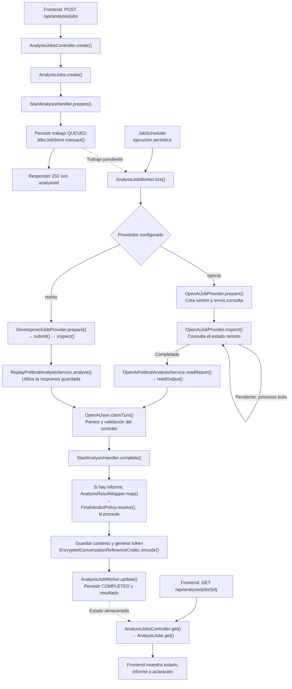

# Workflow de ejecución de una consulta en Java

Revisado el 06/10/2026. Describe el flujo asíncrono utilizado por el frontend y las variantes `openai` y `replay`.

Java registra la consulta, la procesa en segundo plano y guarda el resultado. El frontend consulta periódicamente el estado del trabajo hasta obtener un informe, una aclaración o un error.

## Diagrama del flujo

El diagrama muestra el camino habitual. Omite las ramas de error, recuperación y las respuestas locales inmediatas.

## Pasos de ejecución

1. **Recibir la consulta — `AnalysisJobsController.create()`.** Recoge el texto, el token de conversación y las credenciales del trabajo. Delega en `AnalysisJobs.create()`.

2. **Aceptar o recuperar el trabajo — `AnalysisJobs.create()`.** Valida la credencial y la clave de idempotencia, identifica peticiones repetidas y, para trabajos nuevos, prepara el contexto, comprueba conflictos y capacidad, y construye el registro que se guardará. Una petición repetida con la misma clave, credencial y contenido recupera el trabajo existente. El apartado siguiente detalla el orden de estas operaciones.

3. **Registrar el trabajo — `JdbcJobStore.transact()`.** Guarda el trabajo como `QUEUED` mediante la operación `save()` de la transacción. El servicio devuelve su identificador sin esperar a OpenAI.

4. **Procesar en segundo plano — `JobScheduler` → `AnalysisJobWorker.tick()`.** El planificador invoca periódicamente al trabajador. Este selecciona un trabajo disponible, controla concurrencia y plazos, y ejecuta su siguiente paso. Los cambios se persisten para permitir seguimiento y recuperación.

5. **Obtener la respuesta — depende del perfil.**
   - **`openai`:** `OpenAiJobProvider.prepare()` crea la sesión y envía la primera consulta. `inspect()` comprueba su evolución en sucesivas ejecuciones del trabajador. Para continuaciones, `prepare()` revisa la sesión existente y `submit()` envía la nueva consulta. Al finalizar, `OpenAiPoliticalAnalysisService.readReport()` llama a `readOutput()` para extraer el texto final del agente.
   - **`replay`:** `DevelopmentJobProvider.prepare()` crea una referencia local; `submit()` no realiza ninguna operación remota. `inspect()` llama a `ReplayPoliticalAnalysisService.analyze()`. El JSON del escenario se cargó al arrancar el servicio. Se comprueba que la consulta coincida con la captura y no hay llamadas a OpenAI.

6. **Interpretar el JSON — `OpenAiJson.claimTurn()`.** Los dos caminos utilizan el mismo parser v3. Convierte la respuesta en un informe o aclaración y valida el contrato mediante los mapeos y comprobaciones de dominio. Java no descarga páginas ni verifica de forma independiente las fuentes.

7. **Construir el resultado — `StartAnalysisHandler.complete()`.** Comprueba la coherencia del turno. Si hay un informe, llama a `AnalysisResultMapper.map()`, que aplica `FinalVerdictPolicy.resolve()` cuando corresponde. Para una afirmación con evidencia factual insuficiente, el predominio único de respaldo o cuestionamiento en las publicaciones puede determinar `SUPPORTED_BY_PUBLICATIONS` o `QUESTIONED_BY_PUBLICATIONS`. Una aclaración no pasa por el mapeo de informe.

8. **Guardar conversación y finalizar.** `complete()` guarda el contexto y genera el token cifrado mediante `EncryptedConversationReferenceCodec.encode()`. Después, `AnalysisJobWorker.update()` persiste el resultado y marca el trabajo `COMPLETED`. La finalización y el almacenamiento del contexto se realizan dentro de la transacción del trabajo.

9. **Entregar al frontend — `AnalysisJobsController.get()` → `AnalysisJobs.get()`.** Autentica el acceso al trabajo, lee su estado almacenado y devuelve el resultado cuando está disponible. Este GET no ejecuta ni repite el análisis; el trabajador avanza independientemente del polling del navegador.

## Detalle de `AnalysisJobs.create()`

Este método coordina la aceptación del trabajo. Todavía no envía la consulta a OpenAI: esa tarea corresponde posteriormente a `AnalysisJobWorker.tick()`.

### Datos de entrada

| Parámetro | Procedencia | Uso |
|---|---|---|
| `key` | Cabecera `Idempotency-Key`, generada por el frontend con `crypto.randomUUID()` | Reconocer un POST repetido y recuperar su trabajo sin duplicarlo. |
| `credential` | Valor de `X-Job-Credential` (frontend actual), o `Authorization: Bearer …` para clientes anteriores, extraído por el controlador | Autorizar el acceso al trabajo. El frontend genera 32 bytes aleatorios y los codifica en Base64URL sin padding. |
| `command` | `StartAnalysisCommand`, construido con `text` y `conversationToken` del cuerpo | Contener la consulta y, si existe, la referencia a la conversación anterior. |
| `requestId` | Atributo establecido por `RequestIdFilter` | Asociar el trabajo y sus posibles errores con la petición HTTP. |

La credencial del trabajo es diferente del token de conversación y de la clave de OpenAI. El frontend guarda la clave de idempotencia, la credencial y el cuerpo antes del primer POST para poder recuperar el trabajo si se pierde la respuesta.

### Operaciones, en el orden del código

1. **Validar la credencial — `credentialHash(credential)`.** Exige una cadena Base64URL canónica de 43 caracteres que represente 32 bytes. Si no cumple el formato, devuelve `401 INVALID_JOB_CREDENTIAL`. Calcula su SHA-256; el trabajo guardará ese hash, no la credencial en claro. En una petición nueva, esta operación valida el formato: no autentica a un usuario ni requiere un login previo.

2. **Validar los datos básicos.** Comprueba que `key` sea un UUID v4 y que existan `command` y su texto. Una clave inválida produce `400 INVALID_IDEMPOTENCY_KEY`; la ausencia del comando o del texto produce `400 INVALID_ANALYSIS_INPUT`. La validación de texto vacío y longitud se realiza después en `StartAnalysisHandler.prepare()` para trabajos nuevos.

3. **Calcular la huella del contenido — `hash(...)`.** Construye un SHA-256 a partir del texto y del token de conversación, incluyendo sus longitudes y diferenciando un token ausente de uno vacío. Esta huella permite detectar si alguien intenta reutilizar la misma clave con otro contenido. No se calcula sobre el JSON HTTP literal: un cambio de formato del JSON no modifica los valores comparados.

4. **Abrir la transacción — `store.transact(...)`.** A partir de aquí, la búsqueda de duplicados, las comprobaciones sobre trabajos existentes y el guardado del nuevo registro ocurren dentro de la transacción del almacén `JdbcJobStore`.

5. **Buscar una petición anterior — `tx.byKey(...)`.** Busca la clave de idempotencia normalizada a minúsculas. Si existe un trabajo, llama a `authenticate(old, access)` para comprobar la credencial y su vigencia; después compara `bodyHash` con la huella recién calculada. Con credencial y contenido correctos devuelve `new Accepted(true, old.view())` y termina, sin preparar otra consulta ni reservar otro trabajo. Una credencial distinta produce `404 ANALYSIS_JOB_NOT_FOUND`, un trabajo caducado produce `410 ANALYSIS_JOB_EXPIRED` y otro contenido produce `409 IDEMPOTENCY_CONFLICT`.

6. **Preparar una consulta nueva — `handler.prepare(command)`.** Valida el texto y, si hay token de conversación, comprueba su validez, revisión, categoría y caducidad, y recupera el contexto. Devuelve un `Prepared` con la entrada para el proveedor o un resultado local de aclaración si el contexto anterior ya no está disponible. Adicionalmente, `create()` comprueba si el proveedor exige contexto y existe una sesión sin contexto: en ese caso también prepara una aclaración local `CONTEXT_UNAVAILABLE`.

7. **Evitar continuaciones incompatibles.** Si la entrada preparada pertenece a una sesión existente, consulta `tx.jobs()` y rechaza otra operación de esa sesión que siga activa o conserve una reserva. También usa `tx.latestContextId(sessionId)` y `codec.decode(...)` para comprobar que el token apunta al último contexto conocido, cuando existe. Estas situaciones producen `409 ANALYSIS_CONFLICT`; evitan procesar en paralelo continuaciones incompatibles o continuar desde un contexto desactualizado.

8. **Comprobar la capacidad.** Cuenta los trabajos no terminados y compara el total con `policy.queueCapacity() + policy.concurrency()`. Si se alcanza el límite, devuelve `429 ANALYSIS_CAPACITY_EXCEEDED`. Esta comprobación solo se alcanza para peticiones nuevas: recuperar un trabajo por idempotencia no consume otra plaza. En el código actual se aplica también antes de guardar una nueva aclaración local.

9. **Construir `AnalysisJob`.** Genera un nuevo `id` mediante `UUID.randomUUID()` y asigna la clave de idempotencia, los hashes de acceso y contenido, el identificador de petición y `provider.identity()`. Guarda la entrada preparada cuando habrá ejecución del proveedor, conserva la sesión si es una continuación y establece inicialmente `status=QUEUED` y `phase=CREATE_SESSION`. Asigna las fechas de creación, actualización, próxima revisión y caducidad según `policy.retention()`.

10. **Distinguir ejecución pendiente de resultado local.** Si ya hay una aclaración local, guarda el resultado y cambia el estado a `COMPLETED` sin consultar al proveedor. En caso contrario llama a `provider.initialize(job)`, el punto de inicialización del proveedor, y deja el trabajo pendiente para el trabajador de segundo plano.

11. **Guardar y devolver — `tx.save(job)` → `new Accepted(false, job.view())`.** Persiste el registro y devuelve su vista pública. El controlador convierte esa respuesta en HTTP y añade `Location`, `Retry-After` y `Cache-Control: no-store`.

### Qué recibe el controlador

`Accepted` contiene `replay` y `job`. Aquí **`replay=true` significa recuperación por idempotencia**, no ejecución con el perfil local `replay`.

| Situación | `Accepted.replay` | Respuesta HTTP de `AnalysisJobsController.create()` |
|---|---|---|
| Trabajo nuevo pendiente | `false` | `202` con identificador y estado. |
| Trabajo nuevo resuelto con aclaración local | `false` | `202`, aunque su estado ya sea `COMPLETED`. |
| Petición repetida cuyo trabajo sigue activo | `true` | `202` con el mismo trabajo. |
| Petición repetida cuyo trabajo ya terminó | `true` | `200` con el estado y resultado o error almacenados. |

Ejemplo: si Java guarda el trabajo pero el navegador pierde la respuesta, el frontend puede repetir el POST con la misma clave, credencial y contenido. `create()` encuentra el registro y lo devuelve; no crea otro análisis ni provoca un segundo envío a OpenAI. En cambio, enviar el mismo texto con una clave nueva se trata como una petición nueva, sujeta a las comprobaciones de contexto y capacidad.

## Precisiones

- El gráfico representa principalmente una consulta nueva. Las continuaciones recuperan contexto y usan una sesión existente. Los escenarios actuales de `replay` son primeros turnos independientes: no simulan continuaciones no grabadas.
- Si no se puede recuperar el contexto previo, el servicio puede completar el trabajo con una aclaración local sin llamar al proveedor.
- Ante errores, el trabajo puede pasar por `RECOVERING` o terminar en `FAILED`. No se reenvía automáticamente una inferencia cuyo envío sea incierto; se intenta reconciliar su estado.
- `StartAnalysisHandler.handle()` corresponde al camino síncrono. El flujo asíncrono actual utiliza `prepare()` y `complete()` por separado.
- `replay` reutiliza `DevelopmentJobProvider` para el ciclo local, pero su respuesta pasa por el parser real de OpenAI. El perfil `dev` tradicional utiliza `DevelopmentPoliticalAnalysisService.analyze()` y sus escenarios sintéticos.
- El token de conversación y la credencial de acceso al trabajo tienen funciones distintas: el primero permite continuar el análisis; la segunda autoriza consultar un trabajo concreto.

## Documentación relacionada

- [Flujo unificado y responsabilidades](../POC/cross-check-service/docs/openai/unified-analysis.md).
- [Configuración y escenarios de replay](../POC/cross-check-service/docs/openai/replay.md).
- [Resultados de las pruebas reales y su reproducción](../POC/cross-check-service/docs/openai/political-v19-replay-review.md).
